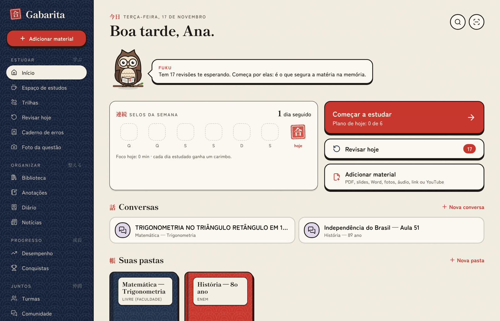
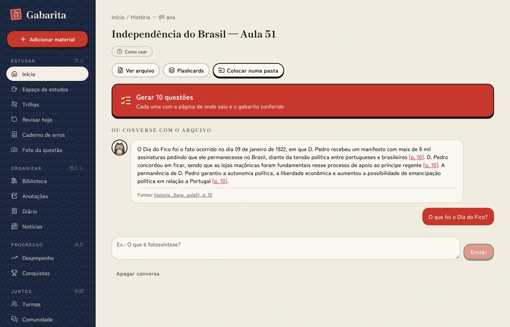
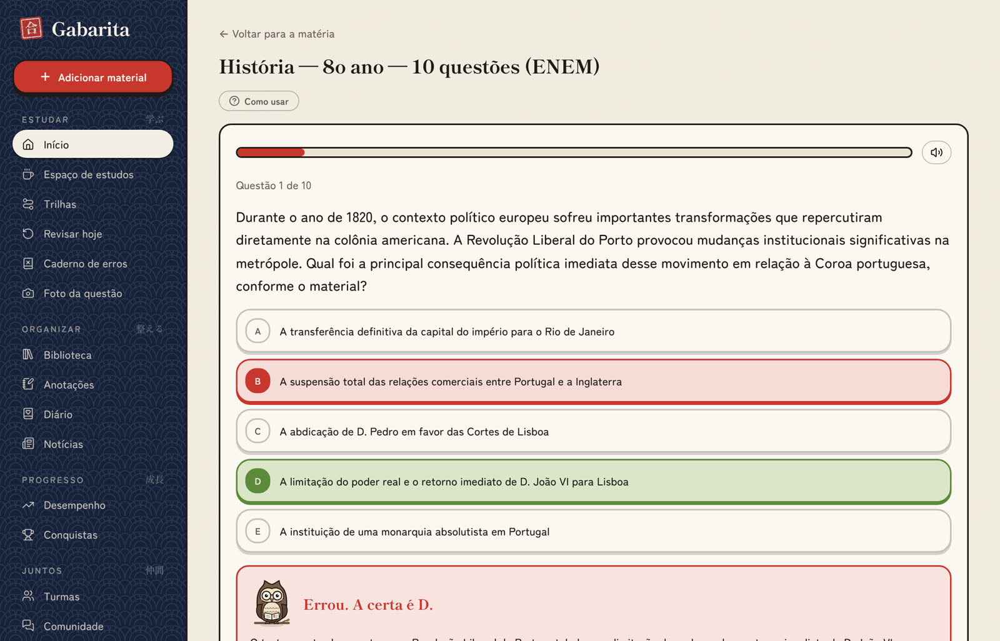
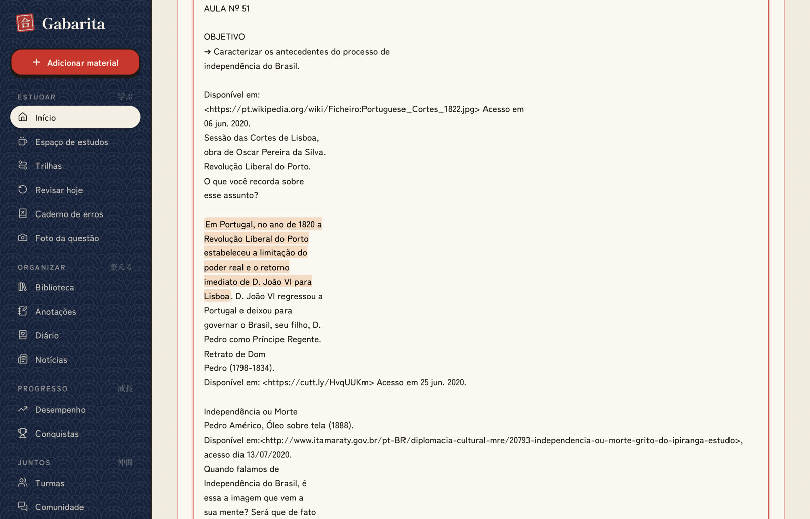
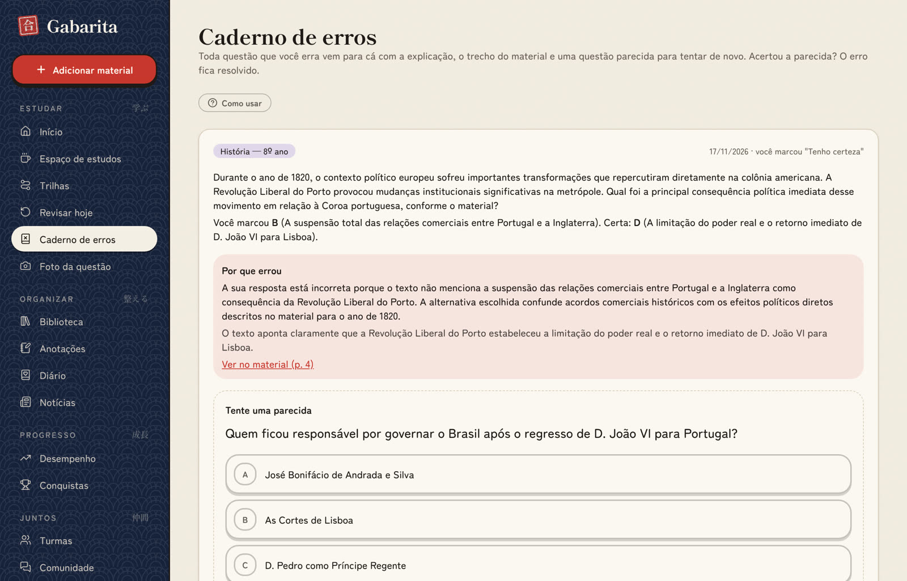
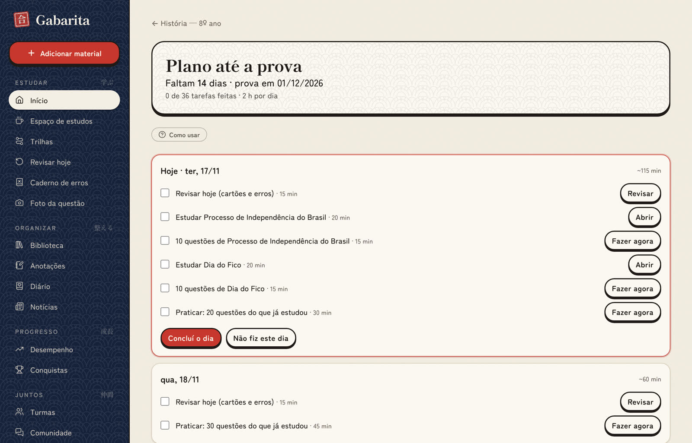
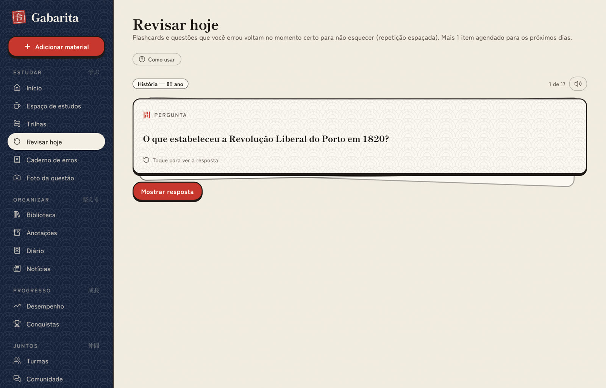
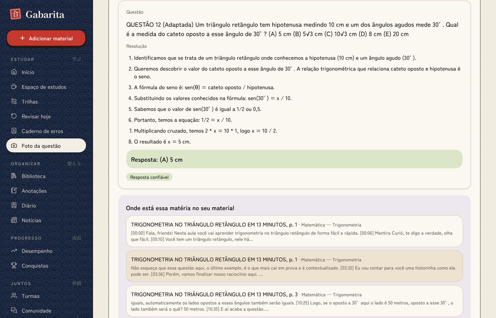
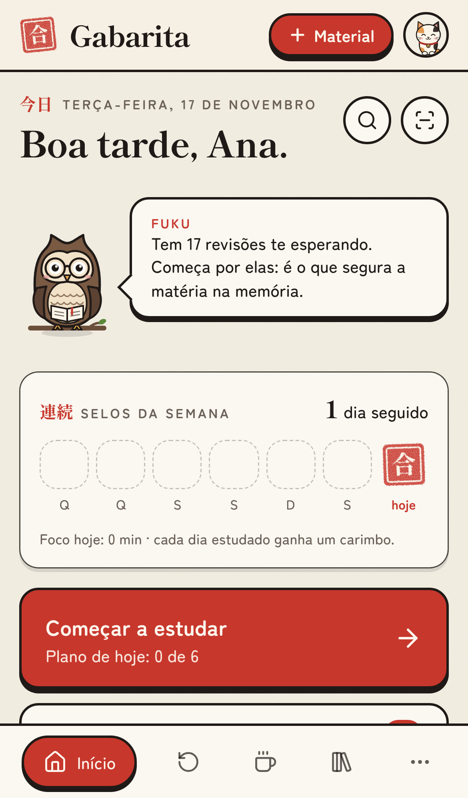

# Gabarita 合

**Manda seu material e a data da prova. O Gabarita monta o plano, as questões e te avisa o que você ainda não sabe.**

Aplicativo de estudo para vestibular, ENEM, concurso e faculdade: o aluno envia PDF, slides, fotos do caderno,
áudio da aula ou um link do YouTube, e o Gabarita transforma isso em questões **com a página de onde saíram**,
**gabarito conferido**, caderno de erros, revisão espaçada e um plano diário até o dia da prova.

🔗 **No ar:** https://gabarita-6wt6.vercel.app

**Conta de demonstração** (já tem uma videoaula de trigonometria com quiz respondido, caderno de erros e flashcards):

| E-mail | Senha |
|---|---|
| `demo@demo.gabarita.app` | `estudar-2026` |

<p>
  
</p>

## O que ele faz

| | |
|---|---|
|  | **Cada arquivo vira uma conversa.** Um toque gera 10 questões só daquele arquivo. O chat responde só com base no material e cita a página. |
|  | **Toda questão tem fonte.** Antes de responder, o aluno marca a confiança (chutei / acho / certeza). Depois vem a explicação e o link para a página exata. |
|  | **"Ver no material"** abre o trecho com a frase que comprova a resposta destacada. |
|  | **Caderno de erros automático:** por que errou, o trecho certo e uma **questão parecida nova** para tentar de novo. |
|  | **Plano reverso até a prova:** tarefas de cada dia (estudar, questões, revisão, simulado na véspera). Faltou um dia? Ele se reorganiza. |
|  | **Revisão espaçada (FSRS):** flashcards e questões erradas voltam no momento em que estão quase sendo esquecidos. |
|  | **Foto da questão:** resolve passo a passo e mostra onde aquele assunto está no material do aluno. |
|  | **Feito para o celular**, com identidade própria: papel washi, carimbos e três personagens (Mochi, Daru e Fuku) que comemoram e explicam. |

Também tem: simulado cronometrado com estilo de banca (ENEM, Cebraspe certo/errado, FGV...), "Prova do Professor"
(aprende o estilo de provas antigas e mostra os tópicos com mais chance de cair), discursivas corrigidas com
rubrica, modo Feynman (explicar por texto ou voz), mapa de domínio por tópico, medidor de falsa certeza, turmas com
ranking semanal, biblioteca com busca por sentido, anotações, diário, conquistas e um perfil com avatar.

## Decisões técnicas que valem a pena olhar

- **Gabarito conferido às cegas** (`lib/generate/answer-check.ts`): depois de gerar, outra chamada da IA resolve
  cada questão **sem ver a resposta**, só com o trecho. Discordou → a questão é descartada. Em teste com material
  real, 40+ questões conferidas à mão: todas com o gabarito certo.
- **Citação literal obrigatória** (`validateQuestions`): a IA devolve a frase do material que comprova a resposta;
  o código confere que ela existe no trecho e guarda a página (até dentro de um trecho que atravessa vários slides,
  `lib/text/pages.ts`).
- **Letras equilibradas:** a resposta certa é espalhada por igual entre A, B, C, D em cada lote, para o aluno não
  aprender a "chutar no B".
- **IA trocável** (`lib/ai/`): uma interface (`generateJSON`, `embed`, `transcribe`, `transcribeVideo`) com
  Gemini (grátis), Claude + OpenAI (pago) e uma IA de teste para os testes automáticos. Toda resposta é JSON
  validado com Zod, com 1 nova tentativa. No Gemini grátis: modelo reserva quando o principal está sobrecarregado,
  cache de embeddings e contagem de tokens por aluno.
- **Vídeo do YouTube sem baixar nada:** o Gemini assiste pela URL e devolve a transcrição com os tempos, que viram
  links para aquele ponto do vídeo.
- **Segurança:** Row Level Security em todas as tabelas, toda rota de API passa por `apiRoute` (origem, JSON, login,
  limite de requisições, Zod), proteção contra SSRF nos links, cabeçalhos de segurança, LGPD (política de
  privacidade, aceite no cadastro, apagar conta com tudo).
- **Plano até a prova sem IA** (`lib/planner/plan.ts`): função pura e testada, que redistribui as tarefas quando o
  aluno falta um dia.

## Tecnologias

Next.js 15 (App Router) · TypeScript strict · Tailwind + shadcn/ui · Supabase (Postgres, Auth, Storage, pgvector,
RLS) · Google Gemini / Claude / OpenAI · ts-fsrs · Vitest + Playwright · Vercel.

**Testes:** 180 de unidade, 87 de banco (RLS e regras), 13 ponta a ponta no navegador.

## Para desenvolvedores

O plano completo do produto, as fases e todas as decisões estão em [`CLAUDE.md`](./CLAUDE.md).

### Rodar localmente

Precisa de Node 22+ e Docker.

```bash
npm install
npx supabase start            # sobe Postgres + Auth + Storage locais (Docker)
cp .env.example .env.local    # preencha NEXT_PUBLIC_SUPABASE_ANON_KEY e SUPABASE_SERVICE_ROLE_KEY
npx supabase status           #   ← os valores estão aqui
npm run dev                   # http://localhost:3000
```

### Comandos

| Comando | O que faz |
|---|---|
| `npm run lint` | ESLint |
| `npm run typecheck` | TypeScript (strict) |
| `npm test` | Testes de unidade (Vitest) |
| `npm run test:db` | Testes de RLS contra o Supabase local |
| `npm run test:e2e` | Fluxo ponta a ponta (Playwright). Rode `npm run build` antes |
| `npm run db:reset` | Recria o banco local aplicando as migrations |
| `npm run db:types` | Gera `lib/supabase/database.types.ts` a partir do banco |

### IA real

Por padrão `AI_PROVIDER=mock`: tudo funciona de ponta a ponta com respostas falsas e sem custo
(cada prompt em `lib/ai/prompts/` tem a sua resposta de teste).

**Grátis (Google Gemini):** crie a chave em https://aistudio.google.com → *Get API key* (só precisa de conta
Google, sem cartão) e no `.env.local`:

```
AI_PROVIDER=gemini
GEMINI_API_KEY=...
```

Na cota grátis há limite de pedidos por minuto/dia e o Google pode usar o conteúdo enviado para melhorar
os produtos dele. Para produção com alunos de verdade, prefira um plano pago.

**Pago (Claude + OpenAI):** no `.env.local`:

```
AI_PROVIDER=anthropic
ANTHROPIC_API_KEY=...   # geração (Sonnet 5.5) e OCR de fotos/PDF escaneado (Haiku 5.5)
OPENAI_API_KEY=...      # embeddings text-embedding-3-small (1536 dim) e Whisper
```

Trocar de mock para real **não** reaproveita os trechos já processados: os embeddings falsos não servem
para a busca real. Reenvie os materiais (ou rode `npm run db:reset`).

### Processamento em segundo plano

Upload, OCR, embeddings e a "questão parecida" do caderno de erros rodam como jobs (tabela `jobs`).
Eles começam logo depois da requisição (`after()` do Next) e, se algo travar, a própria tela cutuca
`/api/jobs/process`. Em produção, configure também um cron chamando essa rota a cada minuto com
`Authorization: Bearer $JOBS_SECRET` (na Vercel, `CRON_SECRET` + `vercel.json`).

### Login com Google

1. Crie um OAuth Client (Web) no Google Cloud. Redirect URI: `http://127.0.0.1:54321/auth/v1/callback`.
2. Preencha `SUPABASE_AUTH_EXTERNAL_GOOGLE_CLIENT_ID` e `_SECRET` no ambiente, mude `enabled = true` em
   `[auth.external.google]` no `supabase/config.toml` e reinicie o Supabase.
3. Ponha `NEXT_PUBLIC_GOOGLE_AUTH_ENABLED=true` no `.env.local` para mostrar o botão.

### Agendadores (cron)

Configure chamadas com `Authorization: Bearer $JOBS_SECRET`:

| Rota | Frequência | Para quê |
|---|---|---|
| `/api/jobs/process` | 1x por dia (`vercel.json`, limite do plano grátis da Vercel) | rede de segurança da fila (upload, tópicos, provas antigas, caderno de erros) |

No dia a dia a fila não depende do cron: cada envio processa logo depois da resposta (`after()`), a tela do
material chama `/api/jobs/process` enquanto espera, e um job travado volta para a fila depois de 10 minutos.
Na Vercel, crie a variável `CRON_SECRET` (a Vercel manda ela no cabeçalho do cron).

### Antes de publicar (segurança)

No painel do Supabase de produção:

1. **Authentication → Providers → Email**: ligue a confirmação de e-mail e a proteção contra senhas vazadas;
   senha mínima 8 com letras e números (igual ao `supabase/config.toml`).
2. **Authentication → URL Configuration**: `Site URL` e `Redirect URLs` só com o domínio do app (`https://seu-dominio/auth/callback`).
3. **Authentication → Rate Limits**: mantenha os limites de login/cadastro; se aparecer abuso, ligue o CAPTCHA.
4. Rode as migrations (`npx supabase db push`) — elas criam o RLS, os limites de requisição e os tipos de arquivo do Storage.

No servidor (Vercel ou outro):

- `SUPABASE_SERVICE_ROLE_KEY`, `GEMINI_API_KEY` e `JOBS_SECRET` só como variáveis de ambiente do servidor (nunca com `NEXT_PUBLIC_`).
- `JOBS_SECRET` longo e aleatório (ex.: `openssl rand -hex 32`).
- **Nunca** ligue `LINK_FETCH_ALLOW_LOCAL` em produção.
- Sirva só por HTTPS (os cookies ficam `Secure` e o HSTS passa a valer).
- `npm audit --omit=dev` antes de cada deploy.

### Variáveis do servidor (Vercel → Settings → Environment Variables)

| Variável | Para quê |
|---|---|
| `AI_PROVIDER=gemini` e `GEMINI_API_KEY` | IA (obrigatória em produção) |
| `GEMINI_MODEL_FALLBACK` | modelo reserva quando o principal está sobrecarregado (padrão `gemini-3.1-flash-lite`) |
| `CRON_SECRET` | autentica o agendamento diário de `/api/jobs/process` (`vercel.json`) |
| `ADMIN_EMAILS` | e-mails de quem modera a Comunidade (`/moderacao`), separados por vírgula |
| `DEMO_EMAIL` | conta de demonstração: não pode ser apagada por quem está testando |
| `NEXT_PUBLIC_CONTACT_EMAIL` | e-mail de contato mostrado na Política de privacidade (pedidos LGPD) |

### E-mails de confirmação (SMTP próprio)

O e-mail padrão do Supabase manda só ~2 e-mails por hora — uma turma inteira se cadastrando não recebe a
confirmação. Passo a passo para usar um serviço grátis em [`docs/email-smtp.md`](./docs/email-smtp.md).

### Conta de demonstração

`scripts/demo-seed.cjs` monta a conta (pastas, PDF, vídeo, quiz respondido, flashcards, conversa) pelo próprio
site, como um aluno faria:

```bash
BASE=https://gabarita-6wt6.vercel.app EMAIL=demo@demo.gabarita.app PASSWORD=estudar-2026 PDF="Independência do Brasil — Aula 51.pdf" node scripts/demo-seed.cjs
```

Sem `PDF`, o quiz sai do vídeo; `HIST_ID`/`MAT_ID` reaproveitam pastas já criadas. Na nuvem do Claude Code o envio
de arquivo para o Storage é bloqueado pela rede, então lá só a parte do vídeo roda; o PDF se envia pelo navegador.
A conta usa o login público do README; se alguém trocar a senha, crie de novo e rode o script.
